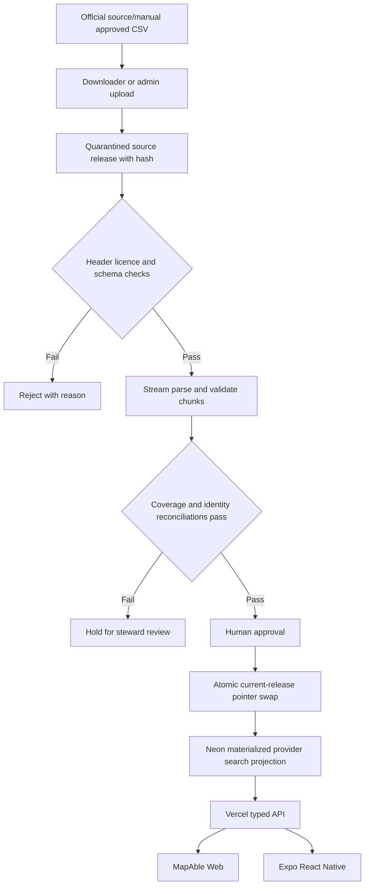

# ADR — National Provider, Worker Screening, Health and Disability Policy Data Federation

**Status:** Proposed / design-only, human approval required; **date:** 2026-11-02  
**Repository:** `ausdisau/MapAble`, canonical main inspected at `43ce85df6b5b09a8577b60bf29042fbc1dc96fb0`  
**Scope:** MapAble Provider Finder, shared Core, Expo/React Native, data provenance, NDIS Advisor and Disability Policy Repository. No production migration, regulatory attestation, private-worker lookup or automated NDIS decision is authorised by this ADR.

## Decision

Retain **Neon PostgreSQL in Sydney** as the operational system of record; retain **Vercel Next.js** as the API/BFF and hosted administrative control plane; use the **Expo/React Native** application as an HTTPS client of that API. Supabase may host a physically and logically separate **public/aggregate analytics projection** after a data-residency and privacy decision; do not dual-write operational entities or transfer identifiable participant, worker or health records to the existing inactive `MapAble` Supabase project in `us-east-1`.

Provider-registration facts, provider/outlet directory data, worker-screening guidance, worker-specific authorised status, public health aggregate indicators and disability policy documents are **six distinct evidence domains**. Their sources and freshness must remain visible. Never infer one domain from another.

## Evidence inspected (2026-11-02)

| Item | Observed state | Consequence |
| --- | --- | --- |
| Neon project `mapableau`, `aws-ap-southeast-2`, PostgreSQL 17 | Project exists. Default branch `production` is reported archived; read-only SQL queries succeeded | Confirm compute/branch deployment readiness separately |
| `public.ndis_providers` | 20,200 rows; 7,128 distinct nonempty ABNs | Directory input, not a current Commission registration certificate |
| `public.provider_outlets` | 77,927 rows; 25,917 distinct nonempty ABNs | Outlet grain differs from organisation grain; counts MUST NOT be summed |
| `public.ndis_provider_ingestion_runs` | Two June 2026 records, one failed and one still `running` | Existing ingest has incomplete lifecycle and stale-run handling |
| `apps/web/README-ingestion.md` | JSON import, Prisma and administrative endpoint documented | Reuse infrastructure, don't overwrite it blindly |
| `apps/web/prisma/schema.prisma` | `NdisProvider`, `ProviderOutletRegistry`, `ProgrammeSourceRecord`, `WorkerProfile` exist | Add separate Commission assertions, not one generic `isVerified` boolean |
| `apps/mobile/.env.example` | `EXPO_PUBLIC_MAPABLE_API_URL` | Native must call Vercel API; never include database credentials |
| Vercel projects `mapableau`, `mapableau-new` | Projects exist, neither reports `live: true` | Do not infer production service availability |
| Supabase project `MapAble` | Inactive; region `us-east-1` | Do not use as production or sensitive-record replica |

Observed source snapshots can be stale. SQL counts do not prove uniqueness across registry and outlet grains, or current legal status. The Commission CSV itself was not parsed in this work; exact column mappings remain a blocking source-schema gate.

## Domain authority and grain

| Domain | Authority | Grain / key | Permitted use | Prohibition |
| --- | --- | --- | --- | --- |
| Commission registered-provider register | NDIS Quality and Safeguards Commission CSV | registration / organisation / registration-group as determined from CSV columns | current published status with source date | worker clearance, quality, accessibility or capacity inference |
| NDIA provider finder | NDIA official JSON, labelled snapshot | organisation/outlet source record | locality and service directory discovery | silently overwrite Commission registration |
| MapAble directory/claims | provider declarations, platform-reviewed evidence | organisation, claimed provider profile, outlet | experience, access-feature evidence and enquiries with status | treating unreviewed or demo records as regulator-verified |
| Worker screening jurisdiction guidance | Commission plus VIC/QLD/ACT/WA units; add NSW/SA/TAS/NT later | jurisdiction + rule/version | route worker/employer to correct check | public lookup of a person's confidential clearance |
| Authorised worker-screening attestation | NWSD or authorised jurisdiction portal, only when lawfully accessed | worker + employer relationship + check + evidence time | role-scoped operational verification with human oversight | scraped portal data; public worker score; automatic hiring decision |
| Public health and disability statistics | AIHW, NDIA public data, national/state open datasets where licensed | dataset release + indicator + geography + reporting period | trends/context with denominator and suppressions | link statistical cells to individual participant profile |
| Disability Policy Repository | official legislation/Hansard/strategies, DPOs, archives, scholarship | source document + dated version + verified excerpt/claim | legal/policy context and chronology with evidence status | treat inferred policy interpretations as enforceable law |

Official sources:
- Commission registered provider data: https://www.ndiscommission.gov.au/provider-registration/find-registered-provider/download-csv
- Commission search: https://www.ndiscommission.gov.au/provider-registration/find-registered-provider
- NDIA provider finder: https://www.ndis.gov.au/sites/default/files/react_extract/provider_finder/build/data/list-providers.json
- Worker screening national hub: https://www.ndiscommission.gov.au/workforce/worker-screening
- VIC: https://www.vic.gov.au/ndis-worker-screening-check
- ACT: https://www.accesscanberra.act.gov.au/business-and-work/working-with-vulnerable-people/wwvp-and-the-ndis
- QLD: https://www.workerscreening.qld.gov.au/
- WA: https://www.wa.gov.au/organisation/department-of-communities/ndis-worker-screening-check
- AIHW: https://www.aihw.gov.au/reports/disability/people-with-disability-in-australia
- NDIA datasets: https://dataresearch.ndis.gov.au/datasets/provider-datasets

## Reference data architecture: existing tables + proposed additive schemas

Use `public.ndis_providers` and `public.provider_outlets` as legacy read-compatible directory tables. No destructive conversion or automatic deduplication by name. Proposed new schemas in **Neon** (names are design contracts, not applied migrations):

1. `source_catalog`: `source_id PK`, `authority`, `source_url`, `dataset_class`, `source_type`, `expected_grain`, `licence`, `retention_policy`, `jurisdiction`, `public_allowed`, `steward`, `reviewed_at`.
2. `source_release`: `release_id UUID PK`, `source_id FK`, `downloaded_at`, `source_as_of`, `sha256`, `schema_fingerprint`, `row_count`, `reject_count`, `staging_status` (`staging|validated|rejected|approved|superseded`), `approver`, `approved_at`, `previous_release_id`. Unique `(source_id, sha256)`; no source becomes current until approved.
3. `source_raw_row`: `(release_id, row_ordinal) PK`, immutable parsed `raw JSONB`, `raw_sha256`, `source_business_key`, `validation_warnings`. Restricted admin/service access; preserve original CSV securely with content hash in approved object storage, outside Git.
4. `provider_entity`: internal UUID, ABN when valid, normalised legal names and aliases; never equate `organisation` and `outlet`. May map to an existing MapAble `Organisation` only following ownership/claim evidence.
5. `provider_source_link`: `provider_entity_id`, `source_id`, `source_business_key`, `match_method` (`registration_number|abn|reviewed_alias`), `review_state`, `reviewer`. Require deterministic exact identifier matching for automatic links; quarantine ambiguous legal-name matches.
6. `provider_registration_assertion`: `provider_entity_id`, `release_id`, `registration_number`, `registration_status`, `registration_group`, `effective_from`, `effective_to`, `source_row_id`, `observed_at`. Multi-row history; no blanket `registered: true` inferred from outlet data.
7. `screening_jurisdiction_rule`: `jurisdiction`, `source_release_id`, `rule_type`, `public_url`, `summary`, `effective_from`, `review_due_at`. Public guidance only. ACT WWVP and NDIS status MUST be distinct dimensions; QLD Blue Card and VIC WWC similarly.
8. `worker_screening_evidence` (future, private): check ID pseudonymised or encrypted, worker/employer scoped reference, authorised NWSD evidence metadata, exact outcome vocabulary, checked time, expiry, reviewer and access log. No public reads; not populated by CSV. Never upload identity documents into generic public-data staging.
9. `health_dataset_release` and `health_indicator_value`: release, dataset, measure code, unit, denominator, population definition, period start/end, geography code and type, value, suppression marker, method notes, citation. **Only aggregate public cells**; suppress unsafe small cells per publisher rules; no participant identifier.
10. `policy_source_document`, `policy_source_version`, `policy_evidence_claim`: original document URL, publisher, date, effective/commencement and repeal/supersession separately, hash, text extraction provenance, evidence status (`CANONICAL|PROBABLE|CANDIDATE|RESEARCH`), verified quotation/pinpoint, rights/NDIS topic tags, human reviewer, Disapedia destination. Preserve historical claims as dated, not current legal guidance.

Reuse `ProgrammeSourceRecord` for authoritative programme applicability only after semantic review; do not collapse a movement history source, a statutory rule and a CSV observation into one authority label.

## Source ingestion and activation



- Download or upload only from an allowlisted authority. Validate TLS, MIME, CSV encodings, header set, row cap, file size and SHA256. CSV spreadsheet injection is not executed; escape on future CSV exports.
- Since the Commission CSV could not be decoded here, first record actual headers, column semantics, row grain, effective dates, status vocabulary, licence and update cadence. A column-mapping table must be code-reviewed before any writes.
- Stream/chunk ingestion into staging with idempotent `release_id,row_ordinal` keys. Reject malformed ABNs, conflicting duplicate registration keys and unknown statuses rather than filling them by guess. Do not assume every CSV row is one organisation.
- Compare row counts, distinct ABNs and registration numbers, status distribution, removal/suspension changes, source dates and schema fingerprints to prior approved release. A high-impact withdrawal needs human review before public status changes.
- After full validation, approve and atomically switch the current release. Keep previous releases for audit/rollback. Do not delete records absent from a newer source without interpretation; display `not present in latest approved snapshot` instead of `revoked`.
- Run detection on a scheduled worker, with Vercel cron only as a bounded trigger. Avoid processing tens of thousands of records inside a single web request; Vercel does not retry failed cron invocations automatically.
- Require rate limiting, timeouts, immutable audit log, alerting for stale release, provenance per visible assertion, restricted admin actions and reconciliation logs.

## Public response contract (web and native)

Expose a versioned `GET /api/v1/provider-registry/search` behind the existing Next.js service, with bounded pagination and filters by name, ABN, state, postcode, registration groups and effective registration state. Return:

```json
{
  "data": [
    {
      "providerId": "internal-reference",
      "displayName": "Example provider (synthetic)",
      "abn": null,
      "state": "NSW",
      "services": [],
      "registration": {
        "value": "unknown",
        "source": "ndis-commission-provider-register",
        "asOf": null,
        "basis": "not_verified_from_current_release"
      },
      "workerScreening": {
        "value": "not_independently_verified",
        "publicVerification": false
      },
      "accessibility": {
        "evidenceStatus": "unknown",
        "features": []
      }
    }
  ],
  "meta": {"releaseId": null, "sourceAsOf": null, "nextCursor": null}
}
```

Provide `GET /api/v1/worker-screening/jurisdictions` for public regulator **instructions and links only** and `GET /api/v1/research/health-indicators` for aggregate, dated, properly licensed data. Do not create a public worker status API or access-controlled data through the AI agent interface.

For Expo, use existing `EXPO_PUBLIC_MAPABLE_API_URL`; the mobile client sends explicitly entered search text and selected filters, no unsolicited live location. Show `Unknown` / `Not independently verified` / `Source last checked` in accessible text. No colour-only badges, 48pt targets, VoiceOver/TalkBack, AAC-compatible input, large text/zoom, cancellation, offline errors and no-match fallback. Web must meet WCAG 2.2 AA; test equivalent accessibility flows on Android/iOS.

## Access, privacy and decision authority

- **Public:** reviewed Commission assertions and public jurisdiction guidance with visible dates; only the necessary business contact data for legal directory publication.
- **Restricted operational:** worker-specific clearance attestation, employment associations and worker competence; organisation + purpose + worker link, access checks, retention and human review.
- **Sensitive participant:** participant consent, case notes, communication requirements and location: remain in MapAble Core, never automatically mirrored to research/Supabase.
- **Analytics:** aggregate public health statistics only, preserving sampling, denominator, time period and geographic granularity. No small-cell reidentification, individual NDIS funding determination, profiling or automated care allocation.
- **Policy:** reviewed sources, their effective dates and quoted passages. The NDIS Advisor offers explainable decision support, **never** statutory conclusions from model-only inference.

The Commission national NWSD is not an open worker-clearance dataset. Registered/deregistered providers changed portal access on 12 October 2026; unregistered providers and self-managed participants use the appropriate existing portal. Only an authorised employer or participant may check linked worker evidence. The four jurisdiction links are **public navigation**, not bulk worker records.

## Supabase boundary

The connected Supabase `MapAble` project is inactive in the United States. Do **not** activate, migrate, replicate, or publish sensitive data there under this ADR. A future Australian-region, dedicated analytics-only Supabase deployment can receive **allowlisted, aggregate, public, licensed projection tables** via one-way, versioned snapshots after legal/security review; never dual-write Neon operational data and never expose unrestricted service-role keys to mobile/web clients. If a second database adds no proven value, keep public analytical aggregates in Neon to avoid sync and cost complexity.

## Policy Repository semantics

Link each policy assertion to dated source versions, legal hierarchy and direct evidence, not to provider reliability scores. Map to `CANONICAL`, `PROBABLE`, `CANDIDATE`, `RESEARCH`; distinguish law in force, draft consultation, historical government claims, disability-led critique and independent evaluation. The Disapedia publishing pipeline consumes approved excerpts and provenance with editorial sign-off and preserves revision/history.

## Delivery gates

1. **Source contract:** obtain actual Commission CSV bytes/headers, row grain, licence, update date and documented field map. Validate public healthcare source permissions. **Block:** any unknown column semantics.
2. **Neon schema and rehearsal:** create draft Prisma migration on separate branch, apply to disposable Neon preview branch using approved migration workflow; baseline duplicates/ABN reconciliation and whole-release rollback. **Block:** unresolved identity collisions.
3. **API and mobile:** route both web and Expo through one typed Vercel read API; add paging, accessibility labels, timestamps and manual-verification links. **Block:** leakage of worker private fields or demonstration content as factual.
4. **Operational/security:** deploy only after CI, data-quality checks, human approval, secrets/config, feature-flag default off, Australian residency decision, consent/data retention, and rollback tested. **Block:** unapproved US Supabase replication, payment/NDIA-claiming inference or stale register displayed as current.

**Explicitly not authorised here:** downloading private worker data, production mutations, use of restricted health records, live NDIS eligibility or worker hiring decisions, data publication, auto-merge, production deployment.

## Acceptance tests

- Input CSV has changed/unknown headers -> reject before staging activation.
- Same source hash re-run -> idempotent no extra visible providers.
- A provider has 5 outlets -> one organisation identity with 5 distinct outlets; no join multiplication.
- Provider missing in new CSV -> not silently marked revoked; review state surfaced.
- Contradictory ABN/name/reg number -> unresolved conflict queued for human decision.
- Zero/empty/partial CSV -> no change to current public release.
- Failure halfway through batch -> incomplete staging remains invisible; retry/rollback works.
- Source date and observation date differ -> both retained and correctly displayed.
- VIC/QLD/ACT/WA guidance routes to official pages; ACT WWVP remains distinct.
- No worker status evidence -> returns `NOT INDEPENDENTLY VERIFIED`; never `cleared`.
- Health small-cell/suppression flags -> no public value leakage, no individual profile joins.
- Policy draft vs law in force -> distinct labels and provenance.
- Expo with missing server URL -> clear offline/configuration state; no fake live data.
- Keyboard, screen reader, AAC, 200–400% zoom and reduced-motion flows pass (web); TalkBack/VoiceOver and large text pass (native).
